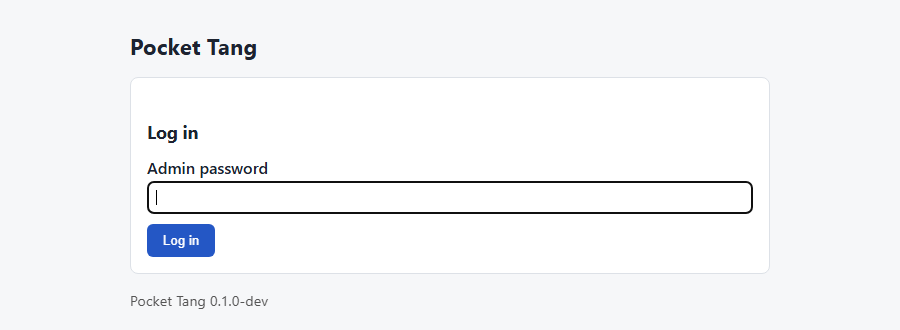

# Pocket Tang

[](https://github.com/BoniFederico/pocket-tang/actions/workflows/ci.yml)
[](https://github.com/BoniFederico/pocket-tang/actions/workflows/firmware.yml)
[](https://bonifederico.github.io/pocket-tang/)
[](https://github.com/BoniFederico/pocket-tang/releases)
[](LICENSE)

**A [Tang](https://github.com/latchset/tang) server for ESP32 microcontrollers.** Network-bound disk
encryption for Clevis/LUKS on a board that costs a few euros.

> **Tang in three lines.** Network-Bound Disk Encryption (NBDE) lets a LUKS-encrypted Linux disk
> unlock automatically, but only while it can reach a Tang server on your network. Tang never sees
> the disk key: the client recovers it through the McCallum-Relyea key exchange. A disk stolen from
> your network stays locked. [Clevis](https://github.com/latchset/clevis) is the client that binds
> LUKS volumes to Tang servers.

## Why

Upstream Tang is a tiny service, yet it usually runs on a Raspberry Pi or a VM that must be patched,
backed up and kept powered. Pocket Tang runs the same protocol on an ESP32. It boots in seconds,
has no operating system to maintain, draws under half a watt and fits behind a router. It is
**wire-compatible with upstream tang and clevis**, verified by an automated interop suite that
compares status codes, advertisements and recovery results byte for byte against upstream `tangd`.

## Features

- `GET /adv`, `GET /adv/{kid}` and `POST /rec/{kid}` with ES512 and ECMR keys on P-521. Thumbprints
  (S1…S512) and key rotation work exactly as in upstream tang.
- Precomputed, signed advertisement. Recovery in about **0.57 s** on an ESP32 with hardware
  big-number acceleration. Stable memory under hostile load ([measurements](https://bonifederico.github.io/pocket-tang/measurements/)).
- Portable C17 core with no ESP-IDF dependency: unit tests under ASan/UBSan, 7 libFuzzer targets,
  clevis interop including real LUKS2 bind/unlock in CI.
- First-boot setup on a WPA2 access point with a captive portal. mDNS hostname.
- Password-protected admin page: key thumbprints, rotation, recovery lock, factory reset.
- BOOT button: hold 3 s for setup mode, hold 10 s for factory reset, with LED feedback.
- Hardening profiles: Secure Boot v1/v2, flash encryption, NVS encryption.
- Browser-based installer (ESP Web Tools).

<p align="center"></p>

## Supported boards

| Target | Status |
|--------|--------|
| ESP32 (ESP32-WROOM-32 DevKit, reference board) | hardware tested |
| ESP32-C3 | built in CI |
| ESP32-S3 | built in CI |
| Raspberry Pi Pico 2 W | planned (new platform layer only, [#19](https://github.com/BoniFederico/pocket-tang/issues/19)) |

## Quick start

1. **Flash** with the [web flasher](https://bonifederico.github.io/pocket-tang/flasher/) (Chrome or
   Edge), or with esptool:

   ```sh
   esptool --chip esp32 --port /dev/ttyUSB0 write-flash 0x0 pocket-tang-v1.0.0-esp32.bin
   ```

2. **Set up.** The serial console prints the setup access point and its password at boot:

   ```text
   PT_SETUP_AP ssid=PocketTang-A1B2 password=k7mnp3qrs8tv url=http://192.168.4.1/admin
   ```

   Join it from a phone, then fill in your 2.4 GHz Wi-Fi, a hostname and an admin password. The
   device restarts and serves Tang on port 80. Give it a fixed IP in your router.

3. **Bind** a LUKS volume, pinning the signing-key thumbprint shown on the admin page:

   ```sh
   sudo apt install clevis clevis-luks clevis-initramfs
   sudo clevis luks bind -d /dev/nvme0n1p3 tang '{"url":"http://192.168.1.214","thp":"<thumbprint>"}'
   sudo update-initramfs -u -k all
   ```

Full guide: [Getting started](https://bonifederico.github.io/pocket-tang/user/getting-started/).

## Security notes

> [!WARNING]
> **A factory reset destroys the Tang keys and breaks every Clevis binding to the device.** Keep
> your LUKS passphrase, and consider binding to two Tang servers with `sss`.

- `/adv` and `/rec` run over plain HTTP by design, as in upstream tang. Clients authenticate the
  server through the pinned thumbprint, and the protocol never reveals the disk key.
- The admin page is off on the LAN by default. Administer the device through the WPA2 setup access
  point, or enable LAN admin only on a trusted network.
- Without hardening, physical access to the board means access to the keys, as with any Tang
  server's disk. Production devices should use the
  [hardening profiles](https://bonifederico.github.io/pocket-tang/user/hardening/), which are
  **irreversible** eFuse operations.
- [Threat model](https://bonifederico.github.io/pocket-tang/design/threat-model/) ·
  [Security policy](SECURITY.md)

## Home Assistant

MQTT integration with Home Assistant discovery (unlock and denied events, counters, a lock switch)
is planned for v1.1.0.

## Documentation

- [User guide](https://bonifederico.github.io/pocket-tang/user/getting-started/): flashing, setup,
  Clevis/LUKS, `sss`, rotation, reset, troubleshooting, hardening
- [Design notes](https://bonifederico.github.io/pocket-tang/design/): lecture-style notes on LUKS,
  Clevis, the McCallum-Relyea exchange, JOSE, the architecture and the testing strategy
- [Architecture decision records](docs/adr/README.md) · [Measurements](docs/measurements.md) ·
  [Development setup](docs/dev-setup.md)

## Contributing

See [CONTRIBUTING.md](CONTRIBUTING.md). Trunk-based workflow, Conventional Commits, every change
through a pull request with green CI.

## License

Apache License 2.0. See [LICENSE](LICENSE).
