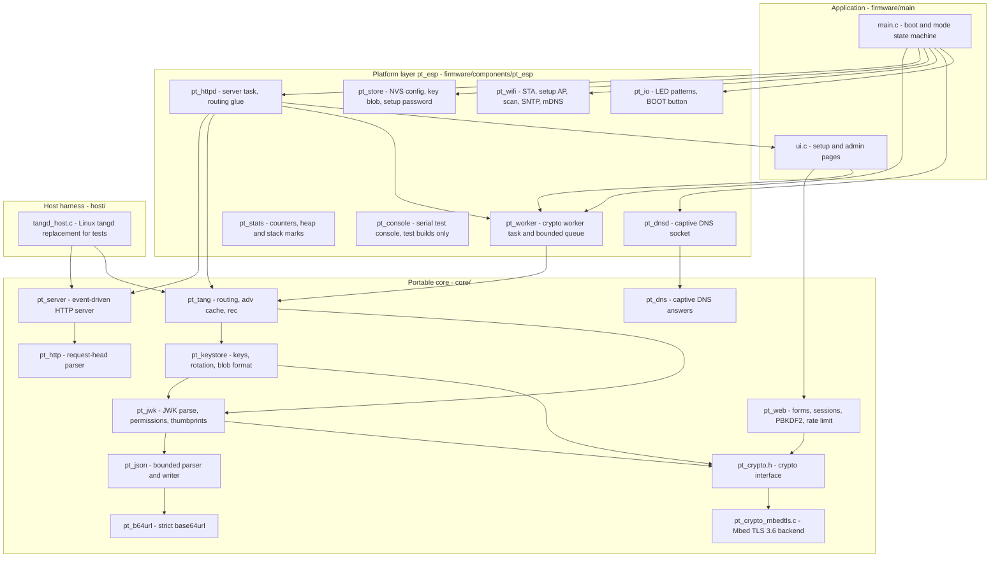
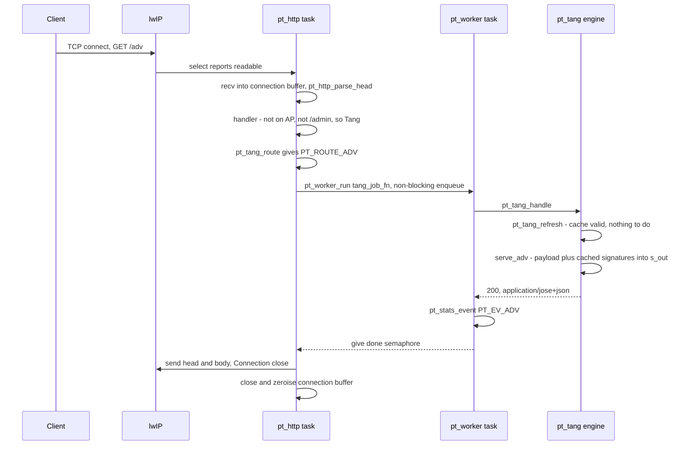
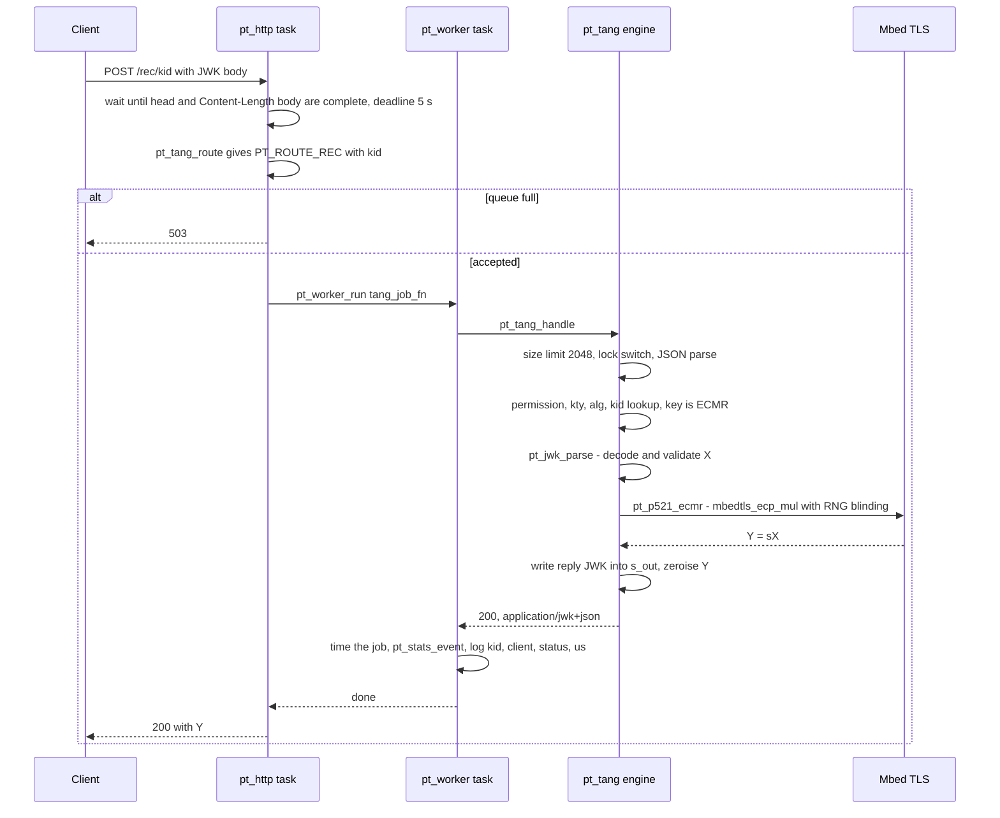
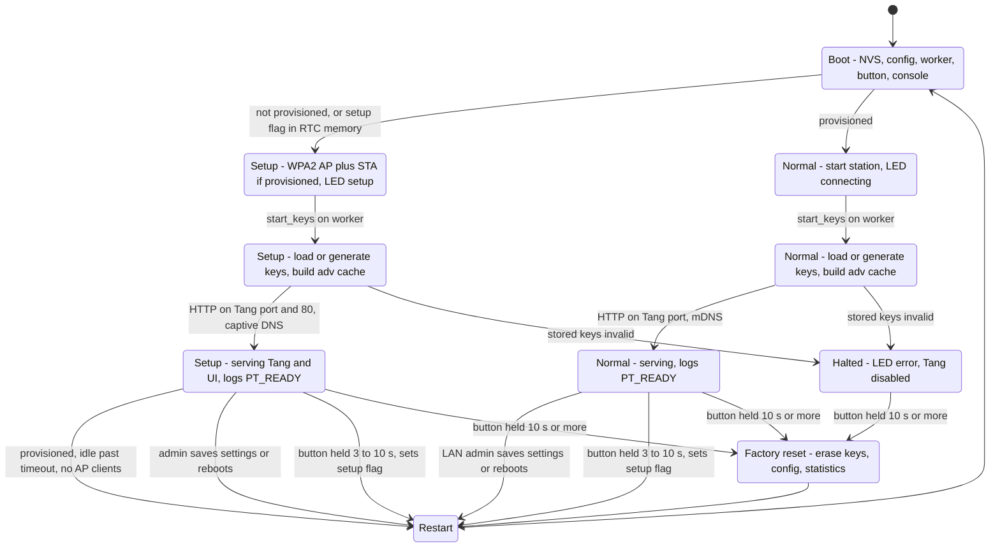

# Architecture

This page describes how the firmware is decomposed, how a request travels through it on the
device, and how the device moves between its operating modes. The guiding rule is a strict
separation between a **portable core**, which knows the Tang protocol but nothing about the
ESP32, and a thin **platform layer**, which knows the ESP32 but nothing about the protocol.

## 1. Layers and components

### 1.1 The portable core (`core/`)

The core is plain C17. It has no ESP-IDF, FreeRTOS or POSIX dependency, with one exception:
`core/net/pt_server.c` uses BSD sockets and `clock_gettime()`, which both Linux and lwIP
provide. The core follows three rules, stated in `pt_common.h` and ADR-0002:

1. **Caller-provided memory.** Every function writes into buffers passed by the caller, with an
   explicit capacity. The core performs no dynamic allocation of its own in the request path.
2. **Fail closed.** Every limit violation, malformed input or backend error returns an error
   code (`pt_err_t`). No partial result is ever used.
3. **One crypto boundary.** All cryptography goes through `core/include/pt/pt_crypto.h`. Only
   `core/crypto/mbedtls/pt_crypto_mbedtls.c` includes Mbed TLS headers
   ([ADR-0001](../adr/0001-esp-idf-version-and-crypto-stack.md)).

| Module | Responsibility | Depends on |
|--------|----------------|------------|
| `pt_common` | error codes, `pt_ct_memeq`, `pt_zeroize` | none |
| `pt_b64url` | strict unpadded base64url | `pt_common` |
| `pt_json` | iterative tokenizer (depth ≤ 8, input ≤ 16 KiB), bounded writer with lexicographic member order | `pt_b64url` |
| `pt_crypto` | hashes, P-521 point/scalar checks, keygen, ECMR, ES512, PBKDF2 | Mbed TLS |
| `pt_jwk` | P-521 JWK parsing, libjose permission rule, RFC 7638 thumbprints | `pt_json`, `pt_crypto` |
| `pt_keystore` | up to 8 keys, rotation, purge, lookup by any thumbprint, blob save/load | `pt_jwk`, `pt_crypto` |
| `pt_tang` | route table, `/adv` cache and serialisation, `/rec`, `/version`, lock switch | all of the above |
| `pt_http` | HTTP/1.x request-head parser, response-head writer | `pt_common` |
| `pt_server` | non-blocking `select()` server: deadlines, connection caps, eviction | `pt_http`, sockets |
| `pt_web` | form decoding, HTML escaping, PBKDF2 passwords, session and CSRF tokens, login back-off | `pt_crypto`, `pt_b64url` |
| `pt_dns` | captive-portal DNS answer builder | `pt_common` |

### 1.2 The platform layer (`firmware/components/pt_esp/`)

Everything that touches ESP-IDF lives here, behind `pt_esp.h`. The application in
`firmware/main/` only calls these functions and the core's public API.

| File | Role |
|------|------|
| `pt_worker.c` | Owns the single `pt_tang_t` engine instance. Runs jobs from a bounded FreeRTOS queue. Registers the RNG (`esp_fill_random`). |
| `pt_httpd.c` | Creates the `pt_srv_t`, runs the polling task, classifies requests (Tang vs UI) and submits Tang work to the worker. |
| `pt_store.c` | NVS namespaces `ptcfg` (configuration) and `ptkeys` (key blob `ks`). Factory reset. Generates the setup-AP password. |
| `pt_wifi.c` | Station mode with exponential reconnect back-off, setup AP (optionally AP+STA), scanning, SNTP, mDNS (`_http._tcp`, TXT `path=/adv`). |
| `pt_dnsd.c` | UDP port 53 socket bound to the AP address, answers through `pt_dns_answer()`. |
| `pt_io.c` | LED patterns on a 50 ms `esp_timer`. BOOT button polled every 20 ms. |
| `pt_stats.c` | Counters and timings behind a spinlock. Heap and stack high-water marks. |
| `pt_console.c` | `provision`, `stats`, `rotate`, `admin`, `button`, `reboot`, `factory-reset`. Compiled only with `CONFIG_PT_TEST_CONSOLE`. |

### 1.3 Tasks on the device

| Task | Created in | Priority | Stack (bytes) | Purpose |
|------|-----------|----------|---------------|---------|
| `main` (`app_main`) | ESP-IDF | default | 4096 (`CONFIG_ESP_MAIN_TASK_STACK_SIZE`) | boot, then the mode loop (LED refresh, setup timeout) |
| `pt_worker` | `pt_worker_start()` | 6 | `CONFIG_PT_WORKER_STACK` = 8192 | all engine and key operations |
| `pt_http` | `pt_httpd_start()` | 5 | 6144 | `pt_srv_poll()` loop, UI handler |
| `pt_dnsd` | `pt_dnsd_start()` | 4 | 3072 | captive DNS, setup mode only |
| `pt_button` | `pt_button_start()` | 3 | 3072 | button timing and actions |
| `pt_restart` | `ui.c` | 2 | 2048 | delayed restart after an admin action |
| esp-mqtt client | `pt_mqtt_start()` | 2 | 6144 | MQTT connection, TLS, incoming commands (only when enabled) |
| `pt_mqtt_pub` | `pt_mqtt_start()` | 1 | 4096 | events, state, discovery publishing (only when enabled) |

The MQTT integration (`firmware/components/pt_mqtt/`, [ADR-0005](../adr/0005-mqtt-home-assistant.md))
is wired to the Tang path through a single listener, `pt_events_set_listener()`. The worker calls
it after each recovery, and it does one non-blocking `xQueueSend` into an 8-entry queue. All
network work happens on the two lowest-priority tasks above.

The Wi-Fi driver, lwIP and the esp_timer service run in their own ESP-IDF tasks. The worker sits
above the HTTP task, so that accepted crypto work finishes quickly, and below Wi-Fi and lwIP
(comment in `pt_worker.c`). The measured stack high-water marks of the worker and HTTP tasks are
in [Performance](performance.md).

## 2. Request flow on the device

### 2.1 Concurrency model

The engine (`pt_tang_t`, which includes the key store) is **not** internally synchronised. Rather
than adding locks, the design gives it a single owner: the `pt_worker` task. Any other task that
needs the engine packages its work as a function and calls `pt_worker_run(fn, arg)`:

- The job is posted to a FreeRTOS queue of length `CONFIG_PT_WORKER_QUEUE_LEN` (default 4)
  **without waiting**. If the queue is full, the call fails immediately with `ESP_ERR_TIMEOUT`
  and the HTTP layer answers **503**.
- Once queued, the caller blocks on a binary semaphore until the job has run. The job runs to
  completion, so it may reference the caller's stack.
- Called from the worker itself, the function runs inline, so nested use cannot deadlock.

The HTTP server task, the admin UI (which runs on the HTTP task), the test console and the boot
code all reach the keys through this one door.

### 2.2 `GET /adv`

`/adv` is assembled from a precomputed cache. The request involves no public-key operation.

### 2.3 `POST /rec/{kid}`

Some details visible in the diagrams:

- **Buffers.** The request lives in the connection's static buffer (`pt_srv_conn_t.buf`,
  head plus body capacity). The response is written into one static buffer `s_out` of
  `PT_TANG_RESP_MAX` = 4096 bytes in `pt_httpd.c`. Sharing `s_out` is safe because there is
  exactly one server task and the job is synchronous.
- **Status codes** are produced in the same order as upstream `tangd`
  ([protocol reference](protocol-reference.md)). Routing errors (404, 405) are answered by the
  HTTP task without involving the worker.
- **Statistics.** The time measured around `pt_tang_handle()` is the "crypto time" that appears
  in [measurements](../measurements.md).

### 2.4 Requests that are not Tang

`pt_httpd.c`'s handler sends a request to the UI handler (`ui_handle()` in `ui.c`) instead of
the engine if:

- it arrived on the setup access-point address `192.168.4.1` (any path; the UI redirects
  everything except `/admin` with a matching `Host` to `http://192.168.4.1/admin`, which
  implements the captive portal), or
- LAN admin is enabled and the path starts with `/admin`.

Everything else, including requests on the LAN in setup mode, goes to the Tang engine.

## 3. Boot and mode state machine

The modes are implemented in `firmware/main/main.c`. A request to enter setup mode is carried
across a restart in RTC memory (`RTC_NOINIT_ATTR s_boot_request` = `"SETU"`), so a mode change
needs no flash write.

Notes on the state machine:

- **Keys are loaded or generated only after Wi-Fi has started** in both modes
  (`pt_wifi_start_*()` precedes `start_keys()`). The ESP32 hardware RNG is a true RNG only while
  the radio is running. See [Cryptography details](crypto.md#11-random-number-generation).
- **Setup mode keeps serving Tang** on the LAN when the device is already provisioned (AP+STA
  mode), so pressing the button does not break unattended boots of bound machines.
- **Setup timeout.** `CONFIG_PT_SETUP_TIMEOUT_MIN` (default 15 minutes) without configuration
  changes and with no station on the AP restarts into normal mode. This applies only when the
  device is provisioned.
- **Halted.** If a stored key blob exists but fails validation, the device refuses to serve
  rather than silently generating new keys. New keys would break every binding without warning.
  The button remains active, so a factory reset can recover the device.
- **Factory reset** is available from every state, including `Halted`. It erases the `ptkeys`,
  `ptcfg` and `ptstat` namespaces and falls back to erasing the whole NVS partition if a
  namespace erase fails.

## 4. The host harness

`host/tangd_host.c` builds the same core for Linux into `tangd-host`. It is a drop-in
replacement for upstream `tangd` in tests:

- `-d KEYDIR` serves an upstream key directory (`*.jwk`; dot-prefixed files are rotated keys),
  imported with `pt_keystore_import()`;
- `-s STATEFILE` serves a Pocket Tang key blob, created on first use; `--rotate` rotates it;
- `--thp`, `--no-tang-pub`, `--lock` and `--timeout-ms` support the interop suite;
- the RNG is `getrandom()`, and the server is the same `pt_server` that runs on the device.

Because the device and the harness share every line of protocol code, the interop suite run in
CI against `tangd-host` tests the firmware's protocol behaviour. The device-specific parts are
covered by the hardware-in-the-loop runner ([Testing](testing.md)).

## 5. Adding a platform: the Raspberry Pi Pico 2 W

The Pico 2 W port is planned (issue #19, listed as "future" in [hardware](../user/hardware.md)). It
illustrates what a platform layer must provide. Nothing in `core/` needs to change.

| Obligation | ESP32 implementation | What a Pico 2 W layer needs |
|------------|----------------------|-----------------------------|
| CSPRNG via `pt_crypto_set_rng()` | `esp_fill_random()` | a hardware or OS entropy source |
| Crypto backend for `pt_crypto.h` | Mbed TLS 3.6 with ESP hardware MPI | an Mbed TLS 3.6 build, or a new backend file implementing the same interface |
| Persistent storage of the key blob and config | NVS (`pt_store.c`) | a flash region or file system that stores the opaque blob from `pt_keystore_save()` |
| Network and HTTP | lwIP sockets + `pt_server` | `pt_server` where a BSD socket API with `select()` is available; otherwise an event loop that feeds `pt_http_parse_head()` and calls `pt_tang_route()` / `pt_tang_handle()` directly |
| Single owner for the engine | worker task + queue | a worker task, or simply a single-threaded main loop |
| Setup and admin UI (optional) | `ui.c` on top of `pt_web` | reuse `pt_web`; the page generation in `ui.c` uses ESP-specific calls and would need porting |
| LED and button | `pt_io.c` | board-specific GPIO code |

The checklist also shows why ADR-0004 replaced `esp_http_server`. Owning the HTTP server
removed one of the largest platform dependencies.

## References

1. ESP-IDF Programming Guide (v5.5): FreeRTOS, NVS, Wi-Fi, lwIP, esp_timer.
   <https://docs.espressif.com/projects/esp-idf/en/stable/esp32/>
2. Pocket Tang ADRs: [0001](../adr/0001-esp-idf-version-and-crypto-stack.md),
   [0002](../adr/0002-own-json-parser.md), [0004](../adr/0004-own-http-server.md).
3. RFC 9112, *HTTP/1.1*. <https://www.rfc-editor.org/rfc/rfc9112>
4. RFC 6762, *Multicast DNS*. <https://www.rfc-editor.org/rfc/rfc6762>
5. RFC 1035, *Domain Names: Implementation and Specification*.
   <https://www.rfc-editor.org/rfc/rfc1035>
