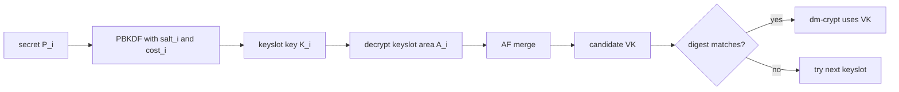
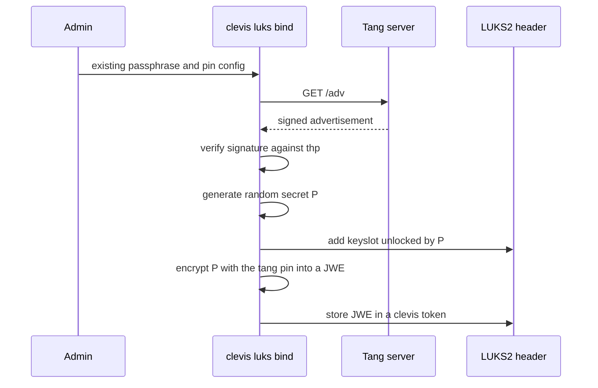

# Background: disk encryption, LUKS2, Clevis and NBDE

This page sets the scene. It explains the problem that a Tang server solves and where the server
sits in the Linux disk-encryption stack. The cryptography of the server itself follows on the next
page, [The McCallum-Relyea exchange](mcallum-relyea.md).

## 1. Encryption at rest

*Encryption at rest* protects data on a storage device that is not in use: a laptop left in a
taxi, a server disk sent back to the vendor, a decommissioned drive. The threat is an attacker who
gains **physical possession of the medium** and reads it with their own equipment. Operating-system
access control does not help against this attacker, because they never run your operating
system.

*Full-disk encryption* (FDE) addresses this threat at the block layer. Every sector is encrypted
with a symmetric **volume key** (also called the master key). On Linux the kernel's `dm-crypt`
target performs the encryption transparently. File systems above it see plaintext blocks, and the
device below it stores only ciphertext.

The volume key is a uniformly random string, typically 256 or 512 bits for AES-XTS. Nobody can
remember it, so the real engineering question is **key management**: where is the volume key kept
while the machine is off, and how does it get back into the kernel at boot?

## 2. LUKS2 in one page

LUKS (Linux Unified Key Setup) is the standard on-disk format that answers that question for
`dm-crypt`. Its current version, LUKS2, is specified by the cryptsetup project [1]. We need only
the parts that matter for automatic unlocking.

### 2.1 Header

A LUKS2 device starts with a header that exists in **two copies**, a primary and a secondary, for
resilience against corruption. Each copy consists of:

- a small **binary header** (magic, version, sequence number, UUID, label, checksum), and
- a **JSON metadata area** that describes everything else.

The JSON area contains five top-level objects:

| Object | Purpose |
|--------|---------|
| `keyslots` | Up to 32 independent encrypted copies of the volume key. |
| `digests` | A PBKDF2 digest of the volume key, used to recognise the correct key. |
| `segments` | Where the encrypted data lives and which cipher protects it. |
| `tokens` | Free-form JSON objects that external tools may attach to keyslots. |
| `config` | Sizes of the metadata areas, flags. |

The encrypted keyslot material itself lives in a binary *keyslot area* after the headers. The
user data follows after that.

### 2.2 Keyslots and the volume key

The central idea of LUKS is **key indirection**. Users never use the volume key $VK$ directly.
Each keyslot $i$ stores $VK$ encrypted under a key derived from a secret $P_i$ (a passphrase, or
a random secret as we will see below):

$$
K_i = \mathrm{PBKDF}(P_i,\ \mathit{salt}_i,\ \mathit{cost}_i), \qquad
A_i = \mathrm{Enc}_{K_i}\big(\mathrm{AFsplit}(VK)\big).
$$

`AFsplit` is the anti-forensic splitter. It expands $VK$ into many stripes (4000 by default), so
that destroying a small part of $A_i$ on disk makes the keyslot irrecoverable. This matters when
a keyslot is wiped on media that remap sectors.

To unlock, cryptsetup tries the supplied secret against each keyslot. It derives $K_i$, decrypts
$A_i$, merges the stripes into a candidate $VK'$ and compares a PBKDF2 digest of $VK'$ with the
stored digest. On a match $VK'$ is the volume key and is loaded into `dm-crypt`.



Two consequences of this design are important for us:

1. **Several independent unlock methods can coexist.** A passphrase in slot 0 and an automatic
   method in slot 1 both decrypt the same $VK$. Adding or removing a method never re-encrypts the
   disk.
2. **The strength of a keyslot is the strength of its secret.** For a human passphrase the PBKDF
   must be deliberately slow: LUKS2 defaults to the memory-hard Argon2 family, and PBKDF2 is also
   supported. For a secret with 256 bits of entropy the PBKDF cost is irrelevant. The interop
   test suite uses `--pbkdf pbkdf2 --pbkdf-force-iterations 1000` only to keep test runs short.

### 2.3 Tokens

A *token* is a JSON object in the LUKS2 header, linked to one or more keyslots. cryptsetup does
not interpret custom token types. They exist so that external tools can store their own metadata
next to the keyslot they unlock. Clevis uses exactly this mechanism (section 5).

## 3. Why automatic unlocking is hard

With a passphrase, the secret lives in a human head, and a stolen disk is useless. Servers in a
rack and unattended machines, however, must reboot **without a human**. So the unlock secret must
be available to the machine at boot.

The naive solution stores the secret on the same machine, for example in an unencrypted `/boot`
partition. This defeats the purpose entirely. Whoever steals the machine also steals the secret.

Stated precisely, we want an unlock factor $F$ with these properties:

- $F$ is **present in the legitimate environment**, so the machine unlocks unattended;
- $F$ is **absent when the device is stolen**, so the thief cannot unlock;
- obtaining $F$ does not require trusting a third party with the volume key.

There are two practical sources for such a factor:

- **The machine's own hardware state**: a Trusted Platform Module (TPM).
- **The network the machine lives in**: a server that answers only on the local network.

## 4. TPM binding vs network binding

| Aspect | TPM binding (`tpm2` pin) | Network binding (`tang` pin) |
|--------|--------------------------|------------------------------|
| Secret is bound to | This motherboard's TPM, optionally to measured boot state (PCRs) | The reachability of a Tang server |
| Protects against | Disk removed and read in another machine; boot chain tampering (with PCR policy) | Whole machine stolen and taken off the network |
| Does not protect against | Whole machine stolen and booted (unless a PIN is added) | Disk *and* Tang server stolen together |
| Fails when | Firmware or boot-chain updates change PCRs; motherboard replaced | Server or network unavailable |
| Infrastructure | None beyond the TPM | One or more Tang servers |

The two factors are complementary. A TPM binds the disk to the *box*. Tang binds the box to the
*place*. Clevis can require both at once (section 6).

!!! note "Failure is graceful"
    In both cases the original passphrase keyslot stays in place. If the automatic method fails,
    because the TPM state changed or the Tang server is down, the boot falls back to a passphrase
    prompt. The [threat model](threat-model.md) therefore treats Tang availability as a usability
    property, not a confidentiality one.

## 5. Clevis: a pluggable decryption framework

[Clevis](https://github.com/latchset/clevis) [2] is the client side of NBDE on Linux. Its core
abstraction is the **pin**: a plug-in that knows how to encrypt a secret under some policy and how
to decrypt it again when the policy is satisfied.

```text
clevis encrypt PIN CONFIG  < plaintext > ciphertext.jwe
clevis decrypt             < ciphertext.jwe > plaintext
```

The ciphertext is a JSON Web Encryption (JWE) object (see [JOSE](jose.md)). Its header records
which pin produced it, so `clevis decrypt` needs no configuration. The pins relevant here are:

| Pin | Policy | Typical CONFIG |
|-----|--------|----------------|
| `tang` | A specific Tang server must answer | `{"url":"http://tang.local","thp":"<signing key thumbprint>"}` |
| `tpm2` | The local TPM must unseal the secret | `{"pcr_ids":"7"}` |
| `sss` | At least $t$ of $n$ sub-pins must succeed | `{"t":2,"pins":{"tang":[{...},{...}]}}` |

For disks, `clevis luks bind` connects the pieces:

1. It generates a fresh random secret $P$ with high entropy.
2. It adds a new LUKS2 keyslot unlocked by $P$. Adding the slot requires an existing passphrase.
3. It encrypts $P$ with the chosen pin, producing a JWE.
4. It stores the JWE in a LUKS2 token linked to the new keyslot.

At boot, an initramfs integration (dracut, initramfs-tools or systemd units shipped with Clevis)
runs the equivalent of `clevis luks unlock`. It reads the token, runs `clevis decrypt` to recover
$P$ and opens the keyslot. The Pocket Tang interop suite exercises exactly this path on a LUKS2
image: `clevis luks bind`, then `clevis luks unlock`, then a failed unlock once the server is
stopped (see [Testing](testing.md)).



The `thp` value pins the server's **signing key**. Clevis accepts the advertisement only if it
carries a valid signature from a key with that thumbprint. Without `thp`, Clevis shows the
advertised keys and asks the administrator to confirm them interactively. This trust-on-first-use
step is the only point where the client must authenticate the server. Recovery itself needs no
authentication, as the next page shows.

## 6. Shamir secret sharing and the `sss` pin

The `sss` pin implements **Shamir's secret sharing** [3]. A secret $a_0$ is split into $n$
shares so that any $t$ of them reconstruct it, while $t-1$ shares reveal nothing about it.

**Splitting.** Over a finite field $\mathbb{F}_q$ with $q > n$, choose random coefficients
$a_1, \ldots, a_{t-1}$ and define the polynomial

$$
f(x) = a_0 + a_1 x + a_2 x^2 + \cdots + a_{t-1} x^{t-1}.
$$

Share $j$ is the pair $(x_j, y_j) = (j, f(j))$ for $j = 1, \ldots, n$.

**Reconstruction.** A polynomial of degree $t-1$ is determined by $t$ points. Given any set $T$
of $t$ shares, Lagrange interpolation at $x = 0$ yields the secret:

$$
a_0 = f(0) = \sum_{j \in T} y_j \prod_{\substack{m \in T \\ m \neq j}} \frac{x_m}{x_m - x_j}.
$$

**Secrecy.** For any $t-1$ shares and *any* candidate secret $a_0'$ there is exactly one
polynomial of degree $t-1$ through those shares and $(0, a_0')$. The shares are therefore
equally consistent with every secret. The scheme is information-theoretically secure, not merely
computationally secure.

Clevis generates a random key for the outer JWE, splits it into $n$ shares, and encrypts each
share with its own sub-pin. Sub-pins may themselves be `sss`, so policies nest. Typical
policies are:

- `{"t":1,"pins":{"tang":[A,B]}}`: either of two Tang servers suffices (availability).
- `{"t":2,"pins":{"tang":[A,B]}}`: both servers are needed (no single server can be stolen
  together with the disk).
- `{"t":2,"pins":{"tang":[A],"tpm2":{}}}`: right box **and** right place.

The interop suite checks the first two shapes with Pocket Tang and an upstream `tangd` side by
side, including the negative case "t = 2 fails with one server down".

## 7. Escrow vs NBDE

Before Tang, the usual answer to unattended unlocking in an enterprise was **key escrow**. The
volume key, or a key that wraps it, is stored on a central server. At boot the client
authenticates and asks for it.

| Property | Key escrow | NBDE with Tang |
|----------|------------|----------------|
| Server stores per-client secrets | Yes, one per disk | No. One key pair serves every client. |
| Server learns the disk key | Yes, by construction | Never (blinded exchange) |
| Transport needs confidentiality (TLS) | Yes, the key travels over the network | No. Plain HTTP is acceptable. |
| Client must authenticate to the server | Yes, otherwise anyone can fetch keys | No. Network reachability *is* the policy. |
| Compromise of the server reveals | Every escrowed key | Nothing by itself. Combined with a copy of a disk header, that disk's key. |
| Server state to back up | A database of keys | The server's key files only |

Escrow is not wrong. It supports use cases NBDE does not, such as recovering a disk after it has
left the network, and it is often used *together* with NBDE for exactly that reason. But escrow
concentrates risk: the escrow database is a high-value target, and its transport must be secret.
Tang removes both requirements. The server never sees the disk key, holds no per-client state,
and can run over unauthenticated HTTP.

How a server can help recover a key it never learns is the subject of the next page.

## 8. Where Pocket Tang fits

Pocket Tang is a Tang server only: it implements the server side of the `tang` pin on an ESP32.
Clevis, LUKS2 and the boot integration stay unchanged on the client. Because the device is small
and cheap, it is natural to deploy two of them and bind with `sss`. The
[threat model](threat-model.md) discusses the new risk that a small device introduces: physical
theft of the server itself.

## References

1. M. Broz et al., *LUKS2 On-Disk Format Specification*, cryptsetup project.
   <https://gitlab.com/cryptsetup/LUKS2-docs>. cryptsetup:
   <https://gitlab.com/cryptsetup/cryptsetup>
2. Clevis, pluggable framework for automated decryption. <https://github.com/latchset/clevis>
3. A. Shamir, "How to share a secret", *Communications of the ACM* 22(11):612–613, 1979.
   <https://doi.org/10.1145/359168.359176>
4. Tang server, README (protocol overview). <https://github.com/latchset/tang>
5. Trusted Computing Group, *TPM 2.0 Library Specification*.
   <https://trustedcomputinggroup.org/resource/tpm-library-specification/>
6. Pocket Tang interop suite, `tools/interop.sh` (sections 4 and 5: `sss` and LUKS2).
