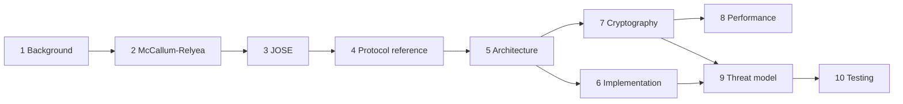

# Design notes

These notes explain how Pocket Tang works and why it is built the way it is. They are written as
lecture notes for engineers and engineering students. We assume you know C and basic
cryptography: hash functions, symmetric encryption, public-key encryption and signatures, and
Diffie-Hellman. We do not assume any knowledge of Network-Bound Disk Encryption (NBDE), Tang,
Clevis or JOSE.

Pocket Tang is a [Tang](https://github.com/latchset/tang) server that runs on an ESP32
microcontroller. A Tang server lets a Linux machine unlock its encrypted disk automatically, but
only while the server can be reached on the network. The server never learns the disk key. The
firmware is wire-compatible with upstream `tangd` and with the `clevis` client. The notes show
how that compatibility is achieved and how it is tested.

## Reading order

The pages build on one another. A first reading should follow the order below. Later pages
refer back to definitions and notation introduced earlier.

| # | Page | Question it answers |
|---|------|---------------------|
| 1 | [Background: LUKS, Clevis, NBDE](background.md) | What problem does a Tang server solve, and where does it sit in the Linux disk-encryption stack? |
| 2 | [The McCallum-Relyea exchange](mcallum-relyea.md) | How can a server help recover a key that it never learns? |
| 3 | [JOSE, JWK, JWS and thumbprints](jose.md) | How are keys, signatures and ciphertexts encoded on the wire? |
| 4 | [Tang protocol reference](protocol-reference.md) | What exactly does upstream `tangd` send and accept? (recorded behaviour) |
| 5 | [Architecture](architecture.md) | How is the firmware decomposed, and how does a request flow through it? |
| 6 | [Implementation choices](implementation.md) | Which design alternatives were considered, and why were these chosen? |
| 7 | [Cryptography details](crypto.md) | Which Mbed TLS primitives are used, and how are they hardened? |
| 8 | [Performance and memory](performance.md) | Where do time and RAM go on a 240 MHz ESP32? |
| 9 | [Threat model](threat-model.md) | What is protected, against whom, and what is out of scope? |
| 10 | [Testing strategy](testing.md) | How do we know the implementation is correct and compatible? |

Pages 1 to 3 are general background and apply to any Tang server. Pages 4 to 10 are specific to
Pocket Tang.

## How the notes map to the code

The repository separates portable protocol code from platform code. The table maps each topic
to the files that implement it. Paths are relative to the repository root.

| Topic | Code | Covered in |
|-------|------|------------|
| Error codes, constant-time compare, zeroisation | `core/include/pt/pt_common.h`, `core/src/pt_common.c` | [Cryptography](crypto.md) |
| Strict base64url | `core/src/pt_b64url.c` | [JOSE](jose.md) |
| Bounded JSON parser and writer | `core/src/pt_json.c`, ADR-0002 | [Implementation](implementation.md) |
| JWK parsing, permissions, RFC 7638 thumbprints | `core/src/pt_jwk.c` | [JOSE](jose.md) |
| Crypto backend interface | `core/include/pt/pt_crypto.h`, `core/crypto/mbedtls/pt_crypto_mbedtls.c` | [Cryptography](crypto.md) |
| Key store and persistence format | `core/src/pt_keystore.c` | [Implementation](implementation.md) |
| Tang engine: routing, `/adv` cache, `/rec` | `core/src/pt_tang.c` | [Architecture](architecture.md), [McCallum-Relyea](mcallum-relyea.md) |
| HTTP head parser and event-driven server | `core/src/pt_http.c`, `core/net/pt_server.c`, ADR-0004 | [Implementation](implementation.md) |
| Admin UI helpers (forms, sessions, PBKDF2) | `core/src/pt_web.c`, `firmware/main/ui.c` | [Implementation](implementation.md) |
| Captive-portal DNS | `core/src/pt_dns.c`, `firmware/components/pt_esp/pt_dnsd.c` | [Architecture](architecture.md) |
| ESP32 platform layer | `firmware/components/pt_esp/` | [Architecture](architecture.md) |
| Boot and mode state machine | `firmware/main/main.c` | [Architecture](architecture.md) |
| Host harness `tangd-host` | `host/tangd_host.c` | [Architecture](architecture.md), [Testing](testing.md) |
| Unit tests, fixtures, fuzzers | `core/tests/`, `core/fuzz/` | [Testing](testing.md) |
| Interop and hardware-in-the-loop | `tools/interop.sh`, `tools/hil/` | [Testing](testing.md) |

## Conventions used in these notes

- **Upstream** means the reference implementation: `latchset/tang` (tang 14), `latchset/jose`
  (jose 13) and `latchset/clevis`, as recorded in the
  [protocol reference](protocol-reference.md).
- **Elliptic-curve notation.** $G$ is the base point of P-521 and $n$ its prime order. Lowercase
  letters ($s, c, e, d$) are scalars in $[1, n-1]$. Uppercase letters ($S, C, E, X, Y, K$) are
  curve points. $sG$ is scalar multiplication. $+$ and $-$ between points are the group
  operation. The [McCallum-Relyea page](mcallum-relyea.md) introduces this in detail.
- **Measured numbers** (latency, heap, stack, image size) are copied from
  [measurements.md](../measurements.md) and were taken on the reference board
  (ESP32-D0WD-V3, 240 MHz). Constants such as buffer capacities come from the source code and are
  labelled as such. They are not measurements.
- **ADRs** are the Architecture Decision Records in `docs/adr/`. The notes summarise them and
  link to them. If the notes and an ADR disagree, the ADR records the decision and the code
  records the behaviour.

!!! note "Scope"
    These notes describe firmware version 0.1.0-dev built with ESP-IDF v5.5.6 and Mbed TLS 3.6.7
    ([ADR-0001](../adr/0001-esp-idf-version-and-crypto-stack.md)). Features planned for later
    milestones (MQTT and Home Assistant, a Raspberry Pi Pico 2 W port, HTTPS for the admin page,
    OTA updates) are mentioned only where they influenced the current design.

## References

1. Tang server, `latchset/tang`. <https://github.com/latchset/tang>
2. Clevis, `latchset/clevis`. <https://github.com/latchset/clevis>
3. José, `latchset/jose`. <https://github.com/latchset/jose>
4. Pocket Tang Architecture Decision Records, [`docs/adr/`](../adr/README.md).
5. Pocket Tang measurements, [`docs/measurements.md`](../measurements.md).
