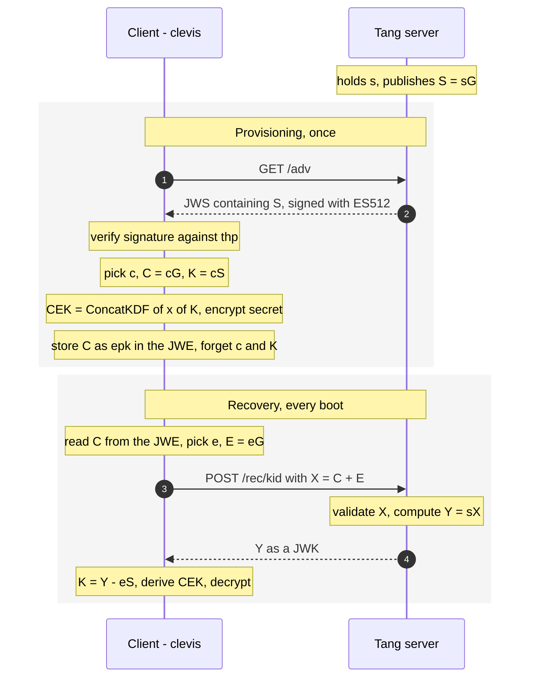

# The McCallum-Relyea exchange

This page is the cryptographic heart of the notes. We first review the elliptic-curve facts we
need. We then derive the McCallum-Relyea (MR) exchange used by Tang, prove that it is correct,
and argue why the server learns nothing about the disk key. Finally we compare it with plain
ECDH and with key escrow, and explain why **point validation** is essential on the server.

The exchange is named after Nathaniel McCallum and Robert Relyea, who designed it for Tang and
Clevis [1]. In JOSE terms the server's exchange key carries the algorithm name `"ECMR"`.

## 1. Elliptic-curve preliminaries

### 1.1 The group

Let $p$ be a large prime and $\mathbb{F}_p$ the field of integers modulo $p$. A short Weierstrass
curve is the set of solutions $(x, y) \in \mathbb{F}_p^2$ of

$$
E:\quad y^2 = x^3 + a x + b,
$$

together with a **point at infinity** $\mathcal{O}$. The points of $E$ form an abelian group under
the *chord-and-tangent* law:

- $\mathcal{O}$ is the identity, and the inverse of $P = (x, y)$ is $-P = (x, -y)$.
- **Addition** ($P_1 \neq \pm P_2$): draw the line through $P_1, P_2$. It meets $E$ in a third
  point, whose reflection is $P_1 + P_2$. Algebraically:

    $$
    \lambda = \frac{y_2 - y_1}{x_2 - x_1}, \qquad x_3 = \lambda^2 - x_1 - x_2, \qquad
    y_3 = \lambda (x_1 - x_3) - y_1 .
    $$

- **Doubling** ($P_1 = P_2$, $y_1 \neq 0$): use the tangent instead,
  $\lambda = (3x_1^2 + a)/(2 y_1)$, with the same formulas for $x_3, y_3$.

!!! note "Keep this in mind"
    The coefficient $b$ appears **nowhere** in the addition and doubling formulas. The formulas
    work for every curve $y^2 = x^3 + ax + b'$ with the same $a$. Section 6 shows why this
    matters.

### 1.2 Scalar multiplication and the discrete logarithm

For an integer $k$ and a point $P$, scalar multiplication $kP = P + P + \cdots + P$ ($k$ times)
is computed with $O(\log k)$ group operations by *double-and-add*. Scan the bits of $k$ from the
most significant one: double the accumulator at each bit, and add $P$ whenever the bit is 1.
Real implementations use windowed or comb variants and projective coordinates, which avoid one
field inversion per step. They also make the sequence of operations independent of the bits of
$k$; see [Cryptography details](crypto.md).

Choose a base point $G$ of prime order $n$, so that $nG = \mathcal{O}$. The **elliptic-curve
discrete logarithm problem** (ECDLP) is: given $G$ and $Q = kG$, find $k$. The related
**computational Diffie-Hellman problem** (CDH) is: given $G$, $aG$ and $bG$, compute $abG$. For
well-chosen curves the best known generic algorithms for both need about $\sqrt{n}$ group
operations.

### 1.3 P-521

Tang uses the NIST curve P-521 (`secp521r1`) [4, 5]:

| Parameter | Value |
|-----------|-------|
| Field prime | $p = 2^{521} - 1$, a Mersenne prime, which allows very fast reduction |
| Coefficient $a$ | $a = -3$, which allows a cheaper doubling formula |
| Coefficient $b$ | a fixed 521-bit constant given in the standard |
| Group order | $n$, a 521-bit prime |
| Cofactor | $h = \#E(\mathbb{F}_p)/n = 1$ |
| Generic attack cost | about $\sqrt{n} \approx 2^{260}$ operations |

**Cofactor 1** means the group of curve points is cyclic of prime order $n$. Every point other
than $\mathcal{O}$ is a generator. There are no small subgroups *on the curve itself*.

A coordinate is an element of $\mathbb{F}_p$, a 521-bit number. JOSE encodes it as a fixed-width
66-byte big-endian string. The top 7 bits of the first byte are always zero.

### 1.4 Notation for this page

| Symbol | Meaning | Who knows it |
|--------|---------|--------------|
| $s$, $S = sG$ | Server exchange key (private, public); $S$ is advertised in `/adv` | server; everyone |
| $c$, $C = cG$ | Client provisioning key; $C$ is stored in the JWE header | nobody after binding; anyone holding the disk |
| $K = cS = sC$ | The point from which the disk-unlock key is derived | nobody stores it |
| $e$, $E = eG$ | Client ephemeral key for one recovery | client, for one boot only |
| $X = C + E$ | Blinded request sent to `/rec` | client, server, eavesdropper |
| $Y = sX$ | Server reply | client, server, eavesdropper |

## 2. The exchange

### 2.1 Provisioning (`clevis encrypt tang`, offline)

Provisioning needs only the server's **public** key, taken from a verified advertisement. The
server is not contacted after `/adv` has been fetched.

1. The client generates a fresh key pair $(c, C = cG)$.
2. It computes the shared point $K = cS = csG$.
3. It derives a symmetric content-encryption key from $K$ and encrypts the secret with it.
4. It stores $C$ in the ciphertext header and **discards $c$**. $K$ is never stored.

Steps 1 to 3 are literally one ECDH-ES key agreement (RFC 7518 §4.6) with the server's exchange
key as recipient. clevis/jose run `ECDH-ES` with content encryption `A256GCM`, so the JWE
protected header carries $C$ as `epk` (ephemeral public key). Concat KDF turns the
$x$-coordinate of $K$ into the 256-bit content key; [JOSE](jose.md) gives the details. The
result is that **the only way to recompute the content key is to recompute $K = sC$**, and that
requires $s$.

### 2.2 Recovery (`clevis decrypt`, at boot)

The client now has $C$ (from the JWE header) and $S$ (from the advertisement stored in the
header). It needs $sC$, but it must not send $C$ to the server.

1. The client generates a fresh ephemeral pair $(e, E = eG)$.
2. It sends the **blinded** point $X = C + E$ to `POST /rec/{kid}`, where `kid` identifies the
   exchange key.
3. The server checks $X$ (section 6) and returns $Y = sX$.
4. The client computes $Y - eS$.

**Correctness:**

$$
Y - eS \;=\; s(C + E) - e(sG) \;=\; sC + sE - esG \;=\; sC + seG - esG \;=\; sC \;=\; K .
$$

The last steps use the fact that scalar multiplication distributes over point addition and that
scalars commute: $s(eG) = e(sG)$.

### 2.3 Why the server must return the full point

The JWE needs only the $x$-coordinate of $K$, but the client must compute $Y - eS$, a point
subtraction, and that needs the full point $Y$. The $x$-coordinate alone fixes $Y$ only up to
sign. In general $-Y - eS$ differs from $\pm(Y - eS)$, so an $x$-only answer would leave two
candidate keys. Upstream jose and clevis do not attempt to resolve that ambiguity. For the same
reason the PSA key-agreement API cannot be used for `/rec`: it returns only the $x$-coordinate
of a shared point. This was the deciding constraint behind the choice of Mbed TLS 3.6
([ADR-0001](../adr/0001-esp-idf-version-and-crypto-stack.md)).

### 2.4 What the repository verifies

!!! note "Upstream behaviour, and what is checked here"
    The [protocol reference](protocol-reference.md) records the **server side** as observed on
    upstream tang 14: the reply to `/rec` is `(x, y) = d_server · (x_req, y_req)` with
    `"alg":"ECMR"`, `"key_ops":["deriveKey"]`, and `tang_pub` from tang 15 on. It does **not**
    record the individual `jose jwk exc` invocations that `clevis-decrypt-tang` uses on the
    client side. The client-side steps above (fresh ephemeral, $X = C + E$, $Y - eS$) follow the
    Tang README [1] and are not independently verified here. What the repository does verify is:

    - `test_ecmr_matches_upstream` (`core/tests/test_crypto.c`): our $sX$ equals the reply that
      upstream `tangd` gave for the same key and request (fixtures in
      `core/tests/fixtures/tang14/`), byte for byte, also with different blinding randomness.
    - `test_mcCallum_relyea_identity`: $s \cdot C = c \cdot S$ for freshly generated keys.
    - `tools/interop.sh`: real `clevis encrypt` / `clevis decrypt` round-trips against Pocket Tang,
      JWEs bound to upstream that decrypt with Pocket Tang and vice versa, and identical
      `/rec` results from both servers for the same request.

    Together these show that whatever clevis computes on the client side, Pocket Tang's server
    step is indistinguishable from upstream's.

## 3. Security argument

### 3.1 The server learns nothing about K

Fix the client's $C$. For a uniformly random $e \in [1, n-1]$, the map $e \mapsto C + eG$ is a
bijection from $[1, n-1]$ onto the set of points other than $C$. (The group is cyclic of prime
order and $G$ generates it.) Hence $X$ is uniformly distributed over $E(\mathbb{F}_p) \setminus
\{C\}$, **whatever $C$ is**. The statistical distance between the distribution of $X$ and a
fresh uniform point is at most $1/n$.

The request therefore carries, in an information-theoretic sense, no information about $C$, and
hence none about $K$. This holds even against a server with unbounded computing power. Two
further consequences follow:

- **Unlinkability.** Two recoveries of the same disk produce independent $X$ values. The server
  cannot tell from the request alone whether it has seen this disk before. It still sees the
  `kid` and the client's IP address, and Pocket Tang counts and logs recoveries; see the
  [threat model](threat-model.md), §5.
- **No per-client state.** Because nothing about the client enters the computation, the server
  needs no per-client records. One key pair serves every binding.

### 3.2 A passive eavesdropper learns nothing useful

An eavesdropper on the LAN sees $X$ and $Y = sX$, and knows $S$ from `/adv`. Consider the
strongest version: the attacker *also* steals the disk later, and so learns $C$. Then they know
$E = X - C$ and need

$$
K = sC = Y - sE .
$$

Computing $sE$ from $S = sG$ and $E = eG$ is precisely CDH. A recorded recovery transcript plus
the stolen disk is therefore no more useful than the disk alone, which already needs $sC =
\mathrm{CDH}(S, C)$. This is why Tang may run over plain HTTP.

### 3.3 An active attacker on the network

An attacker who can modify traffic can replace $Y$ with anything. The client then derives a wrong
key, the AES-GCM tag check fails, and decryption fails. The client never sends anything derived
from $K$ back over the network, so the attacker learns nothing: the attack is a denial of
service only.

The one point where an active attacker can do real damage is **provisioning**. If the client
accepts a forged advertisement, it encrypts to the attacker's exchange key. Clevis prevents this
by verifying the advertisement's ES512 signature against the pinned signing-key thumbprint
`thp`, which must be obtained out of band ([threat model](threat-model.md), asset A2).

### 3.4 An attacker who knows the server key s

This is asset A1 in the [threat model](threat-model.md):

- **With a copy of the disk header:** they read $C$ from the JWE and compute $K = sC$ offline,
  without the network. This is the attack NBDE cannot prevent. It is why the server's key files
  must be protected (flash encryption, NVS encryption) and why `sss` with several servers or a
  TPM raises the bar.
- **With network transcripts only:** $C$ never travels over the network, so knowing $s$ and
  seeing $X, Y$ does not reveal $K$.
- **Impersonation:** they can answer `/rec` in place of the real server. With $s$ alone this
  gives them nothing they could not compute anyway.

Key **rotation** limits the exposure window for future bindings. Old bindings keep depending on
the old $s$ until the clients are re-bound and the rotated key is purged.

### 3.5 `/rec` as a static Diffie-Hellman oracle

Anyone who can reach the server can obtain $sX$ for any valid point $X$ of their choice. Such a
"static DH oracle" is known to weaken the discrete-logarithm problem somewhat: with many oracle
queries, the work to find $s$ drops below the generic $\sqrt{n}$ by an amount that depends on the
factorisation of $n - 1$ or $n + 1$ (Brown and Gallant [6], Cheon [7]). For a 521-bit group the
remaining work is still far out of reach. In addition, the device answers at most about two
recoveries per second (one scalar multiplication takes 531–546 ms on the reference board, see
[measurements](../measurements.md)), and the lock switch can stop recoveries entirely.

## 4. Comparison with plain ECDH and with escrow

| | Plain ECDH (client sends $C$) | Key escrow | McCallum-Relyea |
|-|-------------------------------|------------|-----------------|
| Request reveals | $C$, so the server's reply $sC$ **is** $K$ | client identity | a uniformly random point |
| Server learns $K$ | yes | yes | no |
| Eavesdropper learns $K$ | yes, the reply is $K$ | yes, unless TLS is used | no, needs CDH |
| Server state per client | none | one key per client | none |
| Transport security needed | confidentiality | confidentiality and authentication | none for recovery |
| Server compromise reveals | every $K$ that was ever requested | every escrowed key | $K$ only together with each disk's header |

MR is "ECDH plus blinding". The server performs exactly the operation it would perform in a
static-key ECDH ($s \cdot \text{point}$). The client adds a one-time mask $E$ before and removes
its image $eS$ afterwards. The idea resembles Chaum's blind signatures: the server applies its
secret to a value it cannot recognise.

## 5. Where the exchange lives in the code

| Step | Code |
|------|------|
| Parse request JWK, check `key_ops`/`use`, `kty`, `alg` | `serve_rec()` in `core/src/pt_tang.c`, `pt_jwk_permits()` in `core/src/pt_jwk.c` |
| Look up the exchange key by `kid` (any of five thumbprint hashes) | `pt_keystore_find()` in `core/src/pt_keystore.c` |
| Decode and validate $X$ | `pt_jwk_parse()` → `pt_p521_point_check()` |
| Compute $Y = sX$ with blinding | `pt_p521_ecmr()` in `core/crypto/mbedtls/pt_crypto_mbedtls.c` |
| Serialise $Y$ (plus `tang_pub`) | `serve_rec()` |

The validation order and the resulting status codes mirror upstream exactly (see the
[protocol reference](protocol-reference.md)).

## 6. Point validation and invalid-curve attacks

Recall the remark in §1.1: the addition formulas do not involve $b$. Suppose a server computes
$sX$ for a point $X$ without checking that $X$ lies on $E$. An attacker can then send a point
$X'$ on a **different** curve $E': y^2 = x^3 + ax + b'$. The server's arithmetic silently
computes $sX'$ *in $E'$*. The attacker chooses $b'$ so that $E'$ has a subgroup of small prime
order $r$ and picks $X'$ in that subgroup. Then $sX' = (s \bmod r) X'$, and the reply reveals
$s \bmod r$ after at most $r$ trial multiplications. Repeating this for many small primes
$r_1, r_2, \ldots$ with $\prod r_i > n$ and combining the residues with the Chinese Remainder
Theorem recovers $s$ completely. These are **invalid-curve attacks** (Biehl, Meyer and Müller
[8]). They have been demonstrated against real TLS implementations [9].

A Tang server is an especially attractive target, because `/rec` returns the full point $sX$
directly to the attacker: the oracle is perfect. Pocket Tang therefore validates every input
point before using the private key:

1. **Fixed-width decoding.** `x` and `y` must decode to exactly 66 bytes of canonical base64url
   (`pt_b64url_decode_exact`).
2. **Range, curve equation, not infinity.** `pt_p521_point_check()` loads the point with
   `mbedtls_ecp_point_read_binary()` and validates it with `mbedtls_ecp_check_pubkey()`, which
   checks $0 \le x, y < p$ and $y^2 \equiv x^3 - 3x + b \pmod p$, and rejects $\mathcal{O}$.
   `pt_jwk_parse()` performs this check, and `pt_p521_ecmr()` performs it again on its own
   input.
3. **No small subgroup to fall into.** Because P-521 has cofactor 1, a point that passes the
   on-curve check has order $n$. No separate subgroup check is needed.
4. **Result check.** The result is rejected if it is the point at infinity (`point_write()`).
5. **Private scalars** are validated ($1 \le d < n$) when keys are loaded, and every stored key
   must satisfy $dG = $ its stored public point (see [Implementation](implementation.md)).

A request whose point is off the curve gets HTTP 400, as upstream does. The unit test
`test_rejects_invalid_points_and_scalars` and the interop matrix row `rec-offcurve` check this.

!!! warning "Twist attacks do not apply here, but only because full points are used"
    Implementations that work with $x$-coordinates only (Montgomery ladders) must also worry
    about points on the quadratic twist. Tang always transmits and validates full $(x, y)$
    points, so the on-curve check above is sufficient.

## References

1. Tang README, section on the McCallum-Relyea exchange. <https://github.com/latchset/tang>
2. RFC 7518, *JSON Web Algorithms (JWA)*, §4.6 (ECDH-ES). <https://www.rfc-editor.org/rfc/rfc7518>
3. D. Hankerson, A. Menezes, S. Vanstone, *Guide to Elliptic Curve Cryptography*, Springer, 2004.
4. NIST SP 800-186, *Recommendations for Discrete Logarithm-based Cryptography: Elliptic Curve
   Domain Parameters*, 2023. <https://csrc.nist.gov/pubs/sp/800/186/final>
5. SECG, *SEC 2: Recommended Elliptic Curve Domain Parameters*, v2.0, 2010.
   <https://www.secg.org/sec2-v2.pdf>
6. D. R. L. Brown, R. P. Gallant, "The Static Diffie-Hellman Problem", IACR ePrint 2004/306.
   <https://eprint.iacr.org/2004/306>
7. J. H. Cheon, "Security Analysis of the Strong Diffie-Hellman Problem", EUROCRYPT 2006.
8. I. Biehl, B. Meyer, V. Müller, "Differential Fault Attacks on Elliptic Curve
   Cryptosystems", CRYPTO 2000.
9. T. Jager, J. Schwenk, J. Somorovsky, "Practical Invalid Curve Attacks on TLS-ECDH",
   ESORICS 2015.
10. Mbed TLS 3.6, `mbedtls/ecp.h` (`mbedtls_ecp_check_pubkey`, `mbedtls_ecp_mul`).
    <https://github.com/Mbed-TLS/mbedtls>
