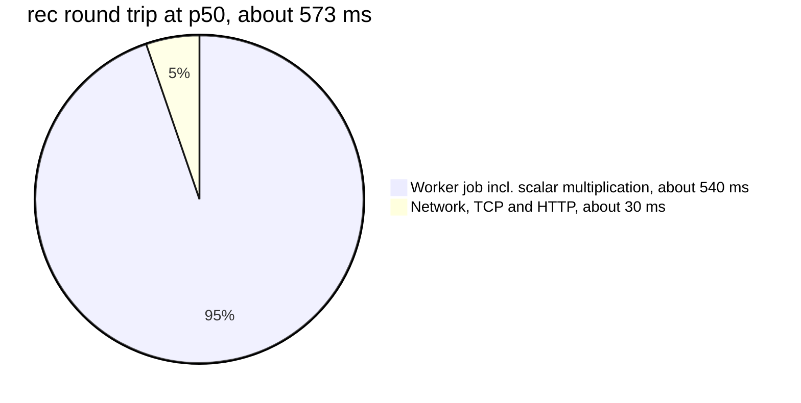

# Performance and memory

This page analyses where time and memory go on the reference board. **Every measured number on
this page is copied from [measurements.md](../measurements.md).** Where we derive a figure from
those numbers, for example a ratio or a difference, the derivation is shown. Where we estimate
something that was not measured, it is labelled as an estimate.

## 1. Measurement setup

From [measurements.md](../measurements.md): ESP32-D0WD-V3 (silicon revision v3.1), 240 MHz dual
core, 4 MB flash, on a 2.4 GHz WPA3 network with RSSI −65 to −71 dBm. Firmware 0.1.0-dev, test
profile, ESP-IDF v5.5.6 and Mbed TLS 3.6.7. The client was a Windows PC on the same LAN using
Python `urllib` with one TCP connection per request. The data was collected by
`tools/hil/pt_hil.py` on 2026-11-13.

## 2. Latency overview

| Configuration | `/rec` p50 | `/rec` p95 | `/adv` p50 | `/adv` p95 |
|---|---|---|---|---|
| `esp_http_server`, Wi-Fi modem sleep (`WIFI_PS_MIN_MODEM`) | 653 ms | 1700 ms | 114 ms | 273 ms |
| `esp_http_server`, power saving off | 622 ms | 710 ms | 92 ms | 96 ms |
| **pt_server, power saving off (default)** | **573 ms** | **612 ms** | **26 ms** | **36 ms** |

Three observations frame the rest of the page:

1. `/rec` is about 22 times slower than `/adv` at p50 in the default configuration
   ($573 / 26$). `/rec` performs one
   P-521 scalar multiplication. `/adv` performs none, because it is served from the precomputed
   cache ([Implementation §5](implementation.md#5-advertisement-cache-with-per-key-deterministic-signatures)).
2. Wi-Fi power saving mostly hurts the **tail** (p95).
3. Replacing the HTTP server improved both endpoints. The relative improvement is much larger
   for `/adv`.

## 3. Where the time goes in `/rec`

The worker measures the device-side duration of the engine call `pt_tang_handle()`: JSON
parsing, permission checks, kid lookup, point validation, the scalar multiplication and
serialisation of the reply. With hardware MPI this "crypto time" has a mean of **531–546 ms**
(maximum 565 ms). The round-trip p50 is 573 ms, so the remainder (network, TCP and HTTP) is
about $573 - 540 \approx 30$ ms, which matches the statement in measurements.md.

Within the worker job the measurements do not break the time down further. The other steps are
linear passes over a request of about 230 bytes (ADR-0003) and a few base64url encodings, so it
is safe to attribute almost all of the 540 ms to `mbedtls_ecp_mul()`. The same cost shows up
elsewhere: loading a stored key at boot, which computes $dG$ once per key, takes about 0.5 s per
key (measurements, "Startup").

**Throughput bound.** All crypto runs on one worker task, so the device completes at most
$1 / 0.546 \approx 1.8$ to $1 / 0.531 \approx 1.9$ recoveries per second. A boot storm of $N$
machines that all unlock at once is therefore served in roughly $N \times 0.57$ s. Requests that
arrive while the worker is busy wait in the HTTP layer, or get 503 if the worker queue is full
([Architecture §2.1](architecture.md#21-concurrency-model)).

## 4. Effect of hardware MPI

| Big-number arithmetic | `/rec` crypto time (mean) | max |
|---|---|---|
| Hardware MPI (`CONFIG_MBEDTLS_HARDWARE_MPI=y`, default) | 531–546 ms | 565 ms |
| Software MPI (`bench-swmpi` profile) | 771 ms | 780 ms |

measurements.md reports a speed-up of **1.45×**. Only part of the work is accelerated: ESP-IDF
offloads multi-precision multiplication to the accelerator, while additions, subtractions,
reductions and the control flow of the comb algorithm remain in software. Amdahl's law bounds
the share of the software-MPI time that the accelerated part must represent. If a fraction $f$
of the original time is accelerated by a factor $a$, the overall speed-up is

$$
S = \frac{1}{(1 - f) + f/a}.
$$

Even with an infinitely fast accelerator ($a \to \infty$), $S \le 1/(1-f)$. A measured
$S = 1.45$ therefore requires

$$
f \;\ge\; 1 - \frac{1}{1.45} \;\approx\; 0.31 .
$$

So **at least 31 %** of the software-MPI exchange time is spent in operations that the
accelerator takes over. The real share is larger, because the accelerator is not infinitely fast
and each call has setup overhead. The measurements do not determine it exactly.

## 5. Effect of Wi-Fi power saving

In modem-sleep mode the station turns its radio off between beacons and wakes up periodically
to learn from the access point whether frames are buffered for it. A frame addressed to the
device may therefore wait in the access point until the next wake-up. measurements.md
summarises this as "modem sleep adds up to one DTIM interval per request".

| | `/rec` p50 | `/rec` p95 | `/adv` p50 | `/adv` p95 |
|---|---|---|---|---|
| Modem sleep | 653 ms | 1700 ms | 114 ms | 273 ms |
| Power saving off | 622 ms | 710 ms | 92 ms | 96 ms |
| Difference | +31 ms | +990 ms | +22 ms | +177 ms |

The median moves by tens of milliseconds, while the p95 of `/rec` grows by almost a second. This
is the typical signature of a delay that hits some requests hard and others hardly at all.
Because a Tang server is usually mains-powered and its whole purpose is to answer promptly at
boot time, power saving is **off by default** (`CONFIG_PT_WIFI_PS_NONE`). It remains selectable
for battery setups (`CONFIG_PT_WIFI_PS_MIN_MODEM`).

## 6. Effect of the HTTP server change

With power saving off in both cases:

| | `esp_http_server` | `pt_server` | Change |
|---|---|---|---|
| `/adv` p50 / p95 | 92 / 96 ms | 26 / 36 ms | −66 / −60 ms |
| `/rec` p50 / p95 | 622 / 710 ms | 573 / 612 ms | −49 / −98 ms |
| Stress test, valid answers in 120 s | 12 (`200`) | 415 (`200`) + 211 correct 4xx | |
| Stress test, client connection errors | 49 | 0 | |

The latency gain is similar in absolute terms for both endpoints (tens of milliseconds), which
suggests a per-request overhead in the old server rather than a change in the crypto path.
**The measurements do not isolate the cause.** One plausible contributor, not verified, is that
`pt_server` sets `TCP_NODELAY` on every accepted socket. That avoids Nagle-algorithm and
delayed-ACK interactions when a response is written in two `send()` calls (head, then body).

The robustness result is unambiguous. `esp_http_server` read request heads with blocking
receives on its single task, so one slowloris client stalled everyone else. `pt_server` never
blocks on one client and enforces a total deadline per request
([ADR-0004](../adr/0004-own-http-server.md)).

## 7. Why does one P-521 scalar multiplication take about half a second?

This section is a **back-of-the-envelope estimate** to build intuition. It is not a measurement.

**Operation count.** A windowed or comb scalar multiplication with a 521-bit scalar performs
about one point doubling per scalar bit and one point addition every $w$ bits, plus a small
precomputed table of about $2^{w-1}$ points. With $w = 4$ or $5$ that is roughly

$$
521 \text{ doublings} + \approx 120\text{–}150 \text{ additions}.
$$

In Jacobian coordinates on a curve with $a = -3$, a doubling costs about 8 field
multiplications or squarings and a mixed addition about 11 (standard counts, see Hankerson et
al.). Hence

$$
521 \times 8 + 140 \times 11 \;\approx\; 4\,200 + 1\,500 \;\approx\; 6\,000 \text{ field multiplications},
$$

plus a few field inversions to normalise the table and the result, and the coordinate
randomisation.

**Time per field operation.** Dividing the measured mean crypto time by this count gives

$$
\frac{540\ \text{ms}}{6\,000} \approx 90\ \mu\text{s} \;\approx\; 90 \times 10^{-6}\ \text{s} \times 240 \times 10^{6}\ \text{Hz} \;\approx\; 22\,000 \text{ cycles}.
$$

**Is that reasonable?** A 521-bit operand is 17 words of 32 bits. A schoolbook product needs
$17^2 = 289$ word multiplications, and reduction modulo $2^{521} - 1$ is only shifts and
additions. A hand-optimised field multiplication on a 32-bit core with a hardware multiplier
should therefore cost on the order of a thousand or a few thousand cycles, not tens of
thousands. The gap comes from the generic big-number layer: `mbedtls_mpi` objects with
dynamically sized limb arrays, function-call and bounds-checking overhead for every operation,
generic modular reduction and copying, and the constant-time table selection of the comb method,
which reads the whole table at every step. This is the price of using a general-purpose, portable
and well-reviewed library instead of a specialised P-521 implementation. ADR-0001 deliberately
chose that trade-off. It also explains why hardware MPI gives "only" 1.45×: the multiplications
are a minority of the cycles.

The conclusion is that half a second is plausible for a 240 MHz microcontroller running a
generic bignum library. At about 0.57 s round trip it is irrelevant at boot time, when a Clevis
client performs one recovery per bound volume.

## 8. RAM budget

Measured values ([measurements.md](../measurements.md)):

| Measurement | Value |
|---|---|
| Free heap after boot (pt_server, 6 connection buffers) | 146.7 KB |
| Free heap after 120 s + 180 s of stress | 146.6 KB (no leak) |
| Minimum free heap ever (heavy stress, lwIP buffers) | 106.7 KB |
| Largest free block | 110.6 KB |
| Crypto worker stack: size / free at high-water mark | 8192 / 4364 bytes |
| HTTP server task stack: size / free at high-water mark | 6144 / 3536 bytes |
| Static connection buffers (6 × 4 KB) | 24 KB |
| Application image | 0.91 MB (51 % of the 1.9 MB app partition free) |

Derived from these:

- **Worker stack used** at its high-water mark: $8192 - 4364 = 3828$ bytes, a margin of 53 %.
  This is the stack that runs Mbed TLS ECP arithmetic.
- **HTTP task stack used**: $6144 - 3536 = 2608$ bytes, a margin of 58 %. This task also runs
  PBKDF2 for admin logins and renders admin pages.
- **Heap headroom under stress**: even at the lowest point (106.7 KB free) about 73 % of the
  post-boot free heap remains ($106.7 / 146.7$). The largest free block (110.6 KB) shows that fragmentation is not
  a concern.
- **No leak**: 0.1 KB difference after five minutes of mixed valid and hostile load.

The design keeps the request path off the heap ([Implementation §3](implementation.md#3-fixed-buffers-no-heap-in-the-request-path)).
The buffers declared in the source are listed there. Their individual sizes are constants, not
measurements. The 24 KB of connection buffers is the largest single item and was the explicit
cost of ADR-0004.

## 9. Startup

| Phase | Time |
|---|---|
| Power-on to `PT_READY` (Wi-Fi associated, DHCP, keys loaded, server up) | 7–11 s |
| Of which: DHCP/association (dominant), key load with $d \cdot G$ validation | ~0.5 s per stored key |
| Key generation for two P-521 keys at first boot | about 1.6 s |

The per-key load cost grows with the number of rotated keys kept. With the maximum of 8 keys,
validation would take roughly $8 \times 0.5 = 4$ s (an extrapolation, not a measurement). That
is a further, if minor, reason to purge rotated keys once no client depends on them.

## References

1. Pocket Tang, [measurements.md](../measurements.md) (all measured figures on this page).
2. Pocket Tang ADRs [0001](../adr/0001-esp-idf-version-and-crypto-stack.md) and
   [0004](../adr/0004-own-http-server.md).
3. G. M. Amdahl, "Validity of the single processor approach to achieving large scale computing
   capabilities", AFIPS Spring Joint Computer Conference, 1967.
4. D. Hankerson, A. Menezes, S. Vanstone, *Guide to Elliptic Curve Cryptography*, Springer, 2004,
   §3.2 (Jacobian coordinates and operation counts).
5. *IEEE Std 802.11-2020*, power management (TIM, DTIM). <https://standards.ieee.org/>
6. Espressif, *ESP-IDF Programming Guide: Wi-Fi Driver, Station Sleep*.
   <https://docs.espressif.com/projects/esp-idf/en/stable/esp32/api-guides/wifi.html>
7. RFC 9293, *Transmission Control Protocol (TCP)* (Nagle algorithm, delayed ACK).
   <https://www.rfc-editor.org/rfc/rfc9293>
