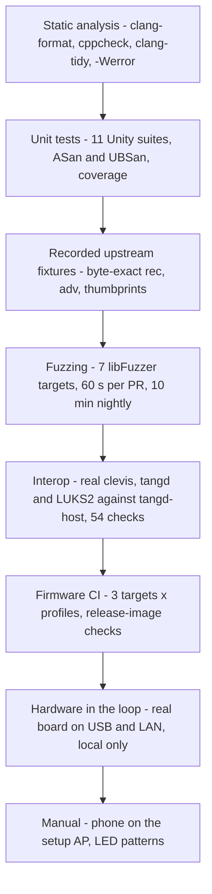

# Testing strategy

A Tang server has two jobs that a test suite must cover. It must be **correct and compatible**:
every byte a Clevis client depends on must match upstream. It must also be **robust**: no input
from the network may crash it, leak a secret or make it stop answering. No single kind of test
covers both, so Pocket Tang layers several, from fast host-side unit tests to a runner that
drives the real board over USB and Wi-Fi.

The first six layers run in GitHub Actions on every pull request (`.github/workflows/ci.yml`,
`firmware.yml`). Nightly fuzzing runs on a schedule (`fuzz-nightly.yml`). The hardware-in-the-loop
runner needs the physical board and runs on the developer's machine.

## 1. Unit tests

The portable core is built for Linux by the top-level `CMakeLists.txt` and tested with
[Unity](https://github.com/ThrowTheSwitch/Unity) v2.6.1. There is one executable per module,
registered with CTest:

| Suite | Focus |
|-------|-------|
| `test_version` | version string |
| `test_b64url` | RFC 4648 and RFC 7515 Appendix C vectors, rejection of padding, standard alphabet and non-canonical trailing bits, capacity checks, all byte values |
| `test_json` | JWK-like objects, nesting and skipping, duplicate keys, escapes, a catalogue of invalid syntax, limits, writer behaviour and errors |
| `test_crypto` | hash vectors, scatter/gather, ECMR against upstream, verification of an upstream signature, sign/verify and determinism, $sC = cS$, invalid points and scalars, RNG required |
| `test_jwk` | thumbprints against `jose jwk thp` for all five hashes, `key_ops`/`use` permission rule, parse validation, write/parse round trip |
| `test_keystore` | initial pair, lookup by every hash, rotation semantics, save/load round trip and tamper detection, import of upstream key files |
| `test_tang` | routing table, `/adv` payload and signatures, `/adv/{kid}`, rotation, byte-exact `/rec`, status matrix, lock switch, no-keys and small-buffer behaviour |
| `test_http` | clevis-style request, limits, malformed heads, response heads |
| `test_web` | form parsing and rejection, HTML escaping, PBKDF2 vectors, passwords, sessions, rate limiting |
| `test_server` | basic and split requests, **slowloris does not block others** (a normal client is served in under 200 ms while a slow one dribbles, and the slow one then gets 408), body too large, bad head, chunked encoding (501), **flood with per-peer cap and eviction** |
| `test_dns` | A query answered, AAAA empty answer, ignored datagrams and error codes |

**Build modes in CI** (`host-tests` job): GCC and Clang with `-DPT_SANITIZE=ON`, which adds
AddressSanitizer and UndefinedBehaviorSanitizer with `-fno-sanitize-recover=all`, so the first
finding fails the test. A third GCC build uses `-DPT_COVERAGE=ON` and produces a `gcovr` report
for `core/src` and `core/crypto`, uploaded as an artifact. All builds use a strict warning set
with `-Werror`: `-Wall -Wextra -Wpedantic -Wshadow -Wconversion -Wsign-conversion -Wcast-qual
-Wformat=2 -Wundef -Wstrict-prototypes -Wmissing-prototypes -Wvla`, plus `-fstack-protector-strong`.

## 2. Recorded upstream fixtures

Compatibility claims are only as good as the reference they are checked against. On 2026-11-13
the behaviour of upstream `tangd` (tang 14, jose 13, Ubuntu 24.04) was recorded into
`core/tests/fixtures/tang14/` ([protocol reference](protocol-reference.md)):

| File | Content | Used by |
|------|---------|---------|
| `sig.jwk`, `exc.jwk` | upstream key files (private) | loaded into the engine as "upstream keys" |
| `adv.json` | upstream `/adv` response | payload and signature comparison |
| `rec_req.json` | a clevis-style `/rec` request (public ECMR JWK) | `/rec` tests, also the HIL client point |
| `rec_rep.json` | upstream's reply to that request | byte-exact comparison |
| `thumbprints.txt` | `jose jwk thp` output for both keys, all five hashes | thumbprint test |

Key assertions:

- **Byte-exact `/rec`.** With `tang_pub` disabled, the reply to `rec_req.json` equals
  `rec_rep.json` byte for byte, including member order and content type
  (`test_rec_byte_exact_with_upstream`). The same request addressed by the S1 thumbprint also
  succeeds. With `tang_pub` enabled, the `x`/`y` values are unchanged and the extra member has
  the expected shape.
- **`/adv` payload.** The decoded payload equals upstream's after removing the spaces that
  upstream's serialiser inserts after `,` and `:`. The response is flattened, and exactly one
  signature verifies with the upstream signing key.
- **Upstream signature verifies** with our ES512 verification (`test_verify_upstream_adv_signature`),
  and a one-bit change makes it fail.
- **Status matrix.** `test_rec_status_matrix_matches_upstream` and `test_routing_matches_upstream`
  assert upstream's status code for each hostile variant (see §4.2).

## 3. Fuzzing

Every parser that sees untrusted bytes has a libFuzzer target in `core/fuzz/`. Fuzz builds
combine `-fsanitize=fuzzer` with ASan and UBSan. A crash, a sanitizer report or an explicit
invariant violation (`__builtin_trap()`) all count as failures.

| Target | Input interpreted as | Invariants checked beyond "no crash" |
|--------|---------------------|--------------------------------------|
| `fuzz_json` | JSON text | `pt_json_skip` always advances and stays in bounds. Every string re-serialised by the writer parses again. |
| `fuzz_b64url` | base64url text, and raw bytes | Decoding accepts only canonical encodings: `encode(decode(x)) == x`. Encoding always round-trips. |
| `fuzz_jwk` | JWK JSON, **and** the same bytes as a key-store blob | A parsed key is on the curve, serialises and has a thumbprint. Blob loading either succeeds with ≤ 8 keys or fails with an **empty** store (fail closed). |
| `fuzz_tang` | method selector byte, request target, body | Whole engine with real keys. 200 responses have a content type and fit the buffer. Error responses have no body. **No 200 response ever contains `"d"`.** |
| `fuzz_http` | HTTP request head | On success: head length, target bounds and length, `Content-Length` ≤ 2048, non-empty method, version 1.0/1.1. Otherwise only "need more" or a negative status. |
| `fuzz_web` | form body, Cookie header, CSRF token | Decoded form values never contain NUL. HTML escaping removes every `<`, `>`, `"` and `'`. Cookie and CSRF checks never crash. |
| `fuzz_dns` | UDP datagram | Replies are either empty or at least a full header, never exceed the buffer (also with a 20-byte buffer), always have the QR bit set and echo the query ID. |

The fuzzers use a fixed-seed RNG so that crashes reproduce. `fuzz_tang` generates keys, rotates
once (so rotated-key paths are reachable) and builds the advertisement cache at start-up.

**Schedule.**

- **Pull requests:** each target runs for 60 s (`-max_total_time=60 -max_len=4096 -timeout=10`),
  seeded from `core/fuzz/corpus/<target>/`. Crash, timeout and leak artefacts are uploaded on
  failure.
- **Nightly:** each target runs for 10 minutes (`-max_total_time=600`) on a corpus restored from
  the previous night's cache, so coverage accumulates over time.

## 4. Interoperability suite

`tools/interop.sh` runs **real** `clevis`, `jose`, upstream `tangd` and `cryptsetup` against
Pocket Tang. In CI it runs against `tangd-host`, the same core built for Linux
([Architecture §4](architecture.md#4-the-host-harness)). Upstream `tangd` is served through
`socat`.

### 4.1 Local mode (CI): 54 checks

| Section | Checks |
|---------|--------|
| 1. Fresh keys | `--thp` matches the advertised key; clevis round-trip with `tang_pub`; `/adv` and `/adv/{kid}` verify with `jose jws ver`; `clevis encrypt` with an `adv` file; round-trip without `tang_pub`; old JWE decrypts after restart; lock switch refuses decryption |
| 2. Rotation | signing key changes; rotated keys are not advertised; a binding made before rotation still decrypts; rotated signing key still served at `/adv/{old kid}`; round-trip after rotation |
| 3. Upstream cross-check on identical keys | advertised key sets identical; `/rec` $(x, y)$ identical; a JWE bound to upstream decrypts with Pocket Tang and vice versa (URLs redirected through `socat`); after an upstream-style rotation (dot-prefixed files): key sets identical, rotated exchange key gives identical `/rec`, rotated signing key served at `/adv/{kid}` by both; then the **status-code matrix** (28 rows) |
| 4. Shamir | `sss` with t = 2 decrypts with both servers; t = 1 decrypts with only Pocket Tang; t = 2 fails with one server down |
| 5. LUKS2 | `cryptsetup luksFormat --type luks2` on a loop device; `clevis luks bind`; `clevis luks unlock`; unlock fails once Pocket Tang is stopped |

That is 8 + 5 + (7 + 28) + 3 + 3 = 54 checks. The LUKS2 section needs root, `dm_crypt` and
`clevis-luks`, all of which the CI job provides (`sudo`).

### 4.2 The status-code matrix

`status_matrix()` sends the same 28 requests to Pocket Tang and to upstream `tangd`, which serve
**the same key directory**, and requires identical status codes. The single allowed difference
is `rec-private` ([ADR-0003](../adr/0003-deviations-from-upstream-tang.md)). The rows, with the
code that Pocket Tang's unit tests assert for the same case:

| Row | Request | Status |
|-----|---------|--------|
| `adv`, `adv-slash`, `adv-dslash` | `GET /adv`, `/adv/`, `//adv//` | 200 |
| `adv-query` | `GET /adv?x=1` | 404 |
| `adv-sig` | `GET /adv/{signing kid}` | 200 |
| `adv-exc` | `GET /adv/{exchange kid}` (exchange keys do not sign) | 404 |
| `adv-unknown` | `GET /adv/AAAA` | 404 |
| `adv-post`, `adv-head` | `POST /adv`, `HEAD /adv` | 405 |
| `unknown` | `GET /nothing` | 404 |
| `rec-get` | `GET /rec/{kid}` | 405 |
| `rec-ok`, `rec-s1` | valid request by S256 kid, by S1 kid | 200 |
| `rec-sigkid` | valid request to the signing key's kid | 403 |
| `rec-unknown` | valid request to `/rec/AAAA` | 404 |
| `rec-badjson`, `rec-array`, `rec-empty` | `{`, `[]`, empty body | 400 |
| `rec-oct` | `{"kty":"oct",...}` | 400 |
| `rec-alg-es512` | `"alg":"ES512"` | 400 |
| `rec-noalg` | `alg` removed | 200 |
| `rec-ops-sign`, `rec-ops-derive` | `"key_ops":["sign"]`, `["deriveKey"]` | 403, 200 |
| `rec-use-sig`, `rec-use-enc` | `"use":"sig"`, `"use":"enc"` | 403 |
| `rec-crv` | `"crv":"P-256"` | 400 |
| `rec-offcurve` | `y` replaced by `x` | 400 |
| `rec-private` | full private JWK | 400 (upstream: 200, documented deviation) |

In CI the matrix is a regression test against upstream itself: if a future upstream release
changes a code, CI reports the mismatch.

### 4.3 External mode: 31 checks against the board

`tools/interop.sh --url http://<device>` tests a running device over the LAN: the advertisement
verifies with `jose`, a clevis round-trip succeeds, `sss` with t = 2 works across the device and
a local upstream `tangd`, and the 28-row matrix is compared with that upstream instance. That is
1 + 1 + 1 + 28 = 31 checks. The hardware-in-the-loop runner invokes this mode.

## 5. Firmware CI

`.github/workflows/firmware.yml` builds the firmware with the pinned ESP-IDF v5.5.6 for `esp32`,
`esp32c3` and `esp32s3` in the `default`, `test` and `secure-sbv2` profiles, plus
`secure-esp32-sbv1` for `esp32`. Two checks guard against configuration mistakes that tests on a
development board would never catch:

- **Release images must not contain the test console.** The job fails if `CONFIG_PT_TEST_CONSOLE=y`
  appears in a non-test `sdkconfig`, or if the string `TEST CONSOLE ENABLED` is found in the
  binary.
- **Secure profiles really are secure.** `CONFIG_SECURE_BOOT=y`,
  `CONFIG_SECURE_FLASH_ENCRYPTION_MODE_RELEASE=y` and `CONFIG_NVS_ENCRYPTION=y` must be set.
  These images are signed with throwaway keys, the keys are deleted afterwards, and the images
  are never published.

## 6. Hardware in the loop

`tools/hil/pt_hil.py` drives the real board through its USB serial port and the LAN. It needs the
**test** firmware profile, whose serial console accepts `provision`, `stats`, `rotate`, `admin`,
`button`, `reboot` and `factory-reset` commands. It prints machine-readable lines such as
`PT_READY`, `PT_STATS`, `PT_LED` and `PT_BUTTON`. The `all` command performs these steps in
order (the code is authoritative; `tools/hil/README.md` lists an earlier, shorter sequence):

1. **Chip identification**: read-only `esptool chip-id`.
2. **Flash, with an eFuse guard.** The runner refuses to flash unless an `sdkconfig` lies next to
   the images, and refuses if it contains `CONFIG_SECURE_BOOT=y`,
   `CONFIG_SECURE_FLASH_ENC_ENABLED=y`, `CONFIG_SECURE_BOOT_V1_ENABLED=y` or
   `CONFIG_SECURE_BOOT_V2_ENABLED=y`. The first boot of such an image would burn eFuses
   irreversibly. It then erases the whole flash and writes the test build.
3. **Provision** Wi-Fi from `.env.test` over the console, reboot and wait for
   `PT_READY ... ip=...`. The Wi-Fi password is redacted from the saved serial log.
4. **Statistics and latency**: `stats`, then `n` (default 50) sequential `/rec` and `/adv`
   requests with min, p50, p95, max and mean, then `stats` again for crypto time, heap and stack
   high-water marks.
5. **Interop over the LAN**: `tools/interop.sh --url` (31 checks, run through WSL on Windows).
6. **Stress** (default 120 s, 6 worker threads): one third valid `/rec`, one third `/adv`, one
   third hostile requests (1500 × `{`, an invalid point, a 3000-byte body, a 300-character kid,
   an unknown kid, `DELETE /adv`). An additional slowloris thread sends one header byte per
   second. After the run, a valid `/rec` must still return 200.
7. **Persistence**: reboot, and the same thumbprints must be advertised.
8. **Rotation**: bind with clevis, `rotate` on the device, check that the signing key changed
   and that the old binding still decrypts.
9. **Button via DTR.** On the DevKit's auto-reset circuit, asserting DTR with RTS released pulls
   GPIO0 low, which is electrically identical to holding BOOT. A medium press must show
   `PT_LED hold-setup`, end in `PT_READY mode=setup` with Tang still answering `/adv` with 200,
   and return to `mode=normal` after a reboot.
10. **Admin UI over the LAN** (`tools/hil/ui_test.py`, after setting an admin password and
    enabling LAN admin through the console): login page and security headers (CSP, `no-store`,
    `X-Frame-Options`), unauthenticated POST refused, back-off engages (429) after wrong
    passwords, login sets a cookie with `HttpOnly`, `SameSite=Strict`, `Path=/admin`, no private
    material on the dashboard, wrong CSRF token refused, rotation through the UI, lock makes
    `/rec` return 403 and unlock restores 200, factory reset requires confirmation, logout.
11. **Factory reset via a long DTR press**: `hold-setup` then `hold-reset` LED states, erase
    message, back in setup mode unprovisioned, then re-provisioned with **disjoint** new keys.
12. **Final statistics** and a JSON report in `hil-artifacts/hil-results.json` (not committed).

The numbers in [measurements.md](../measurements.md) come from these runs. The HIL runner never
burns eFuses and never enables Secure Boot or flash encryption. The reference board stays a
development board ([hardware](../user/hardware.md)).

## 7. Static analysis and formatting

`tools/lint.sh` runs in the `lint` CI job:

- **clang-format** (`--dry-run --Werror`) on all C sources in `core/`, `host/` and `firmware/`.
- **cppcheck** with the `warning`, `style`, `performance` and `portability` checks, with the
  Mbed TLS feature macros defined so that all code paths are analysed.
- **clang-tidy** on `core/src`, `core/crypto`, `core/net` and `host/`, with the `bugprone-*`,
  `cert-*`, `clang-analyzer-*`, `misc-*`, `performance-*`, `portability-*` checks and selected
  `readability-*` checks, all as errors (`.clang-tidy`).

## 8. What still requires a human

Two properties cannot be observed through a serial port and a LAN:

- **Joining the setup access point from a phone** and seeing the captive portal open the setup
  page. This depends on each phone operating system's connectivity probes. It was verified
  manually by the maintainer with a phone on 2026-11-13 (`PROGRESS.md`). Switching the test PC's
  own Wi-Fi to the device's access point would break the HIL session, so this step is not
  automated.
- **Observing the physical LED.** The runner checks the *logical* LED state through the
  `PT_LED` log lines, but not that the LED on GPIO2 actually blinks in the intended pattern.

The irreversible hardening steps (Secure Boot, flash encryption) are also never exercised on the
development board. They are covered only by the build-level checks in §5 and by the procedure in
the [hardening guide](../user/hardening.md).

## 9. Traceability: threats to tests

| Threat ([threat model](threat-model.md)) | Tests |
|------------------------------------------|-------|
| Memory corruption from malformed input | all 7 fuzz targets, ASan/UBSan unit tests, `test_json`, `test_http`, `test_dns` |
| Invalid-curve attacks on `/rec` | `test_rejects_invalid_points_and_scalars`, matrix rows `rec-offcurve` and `rec-crv`, `fuzz_jwk` |
| Key extraction through `/rec` | `fuzz_tang` "no `"d"` in any 200", matrix rows `rec-sigkid` and `rec-private` |
| Slow clients and floods | `test_server` (slowloris, flood, eviction), HIL stress with slowloris |
| Tampered or corrupt key store | `test_keystore` (tamper), `fuzz_jwk` (blob loader fails closed) |
| Admin UI abuse | `test_web`, `fuzz_web`, HIL `ui_test.py` |
| Incompatibility with clients | fixtures, interop suite (54 checks in CI, 31 against the board) |
| Debug features in release images | firmware CI release-image check |

## References

1. Unity test framework. <https://github.com/ThrowTheSwitch/Unity>
2. LLVM, *libFuzzer*. <https://llvm.org/docs/LibFuzzer.html>
3. Clang, *AddressSanitizer*. <https://clang.llvm.org/docs/AddressSanitizer.html>
4. Clang, *UndefinedBehaviorSanitizer*. <https://clang.llvm.org/docs/UndefinedBehaviorSanitizer.html>
5. Cppcheck. <https://cppcheck.sourceforge.io/>
6. Clang-Tidy. <https://clang.llvm.org/extra/clang-tidy/>
7. gcovr. <https://gcovr.com/>
8. Clevis, Tang, José: <https://github.com/latchset/clevis>, <https://github.com/latchset/tang>,
   <https://github.com/latchset/jose>
9. cryptsetup / LUKS2. <https://gitlab.com/cryptsetup/cryptsetup>
10. Espressif, `esptool` documentation. <https://docs.espressif.com/projects/esptool/>
